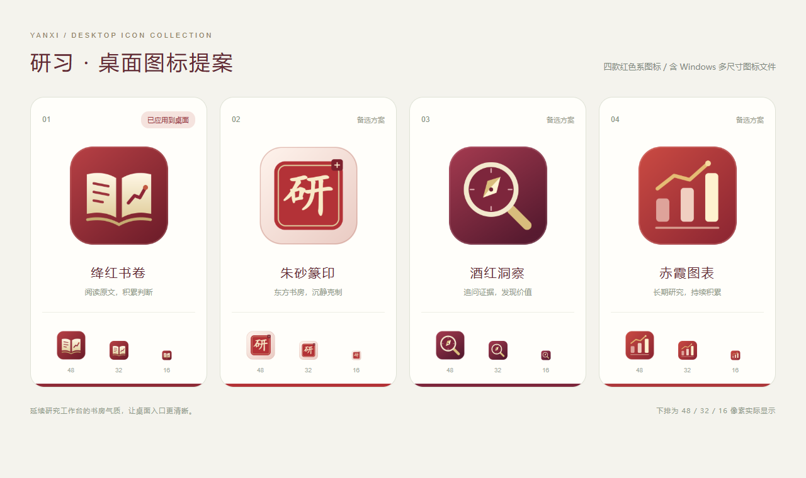

# 研习桌面图标

四款红色系原创矢量方案，每款包含可编辑 SVG、1024像素透明 PNG，以及含16、24、32、48、64、128、256像素的 Windows ICO。保留米白和浅金色细节，保证小尺寸显示清晰。

1. `01-library-red`：绛红书卷。深红底色搭配书页与研究曲线，表达阅读和判断，默认桌面图标。
2. `02-seal-red`：朱砂篆印。暖白底色、朱砂印章与“研”字，延续中文书房气质。
3. `03-insight-red`：酒红洞察。酒红色放大镜和罗盘，表达查证来源与独立研究。
4. `04-value-red`：赤霞图表。赤红色三根立柱与折线，表达财务分析与长期积累。

可右击桌面快捷方式 → 属性 → 更改图标，选择本目录下的 ICO 文件。也可在项目目录运行 `powershell -ExecutionPolicy Bypass -File .\更新桌面图标.ps1 -Design 2`，将数字改为1至4。脚本只替换图标，原快捷方式备份在本机 `data/shortcut-backups/`，保留原启动路径与参数。
